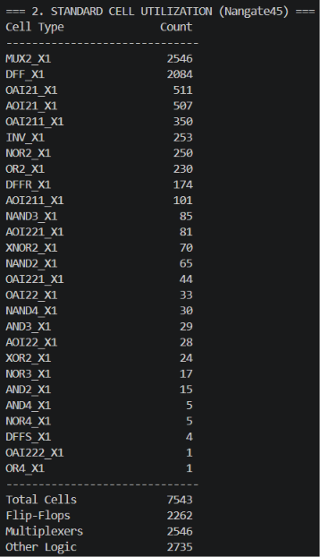

# Multi-Channel Asynchronous FIFO with Round-Robin Arbitration


A parameterized SystemVerilog RTL design that merges multiple independent input clock domains into a single output stream. Each input channel uses an asynchronous FIFO for clock-domain crossing (CDC), while a round-robin arbiter fairly selects the next available channel. An **elastic output register slice** provides Ready/Valid backpressure support and preserves the selected channel's one-hot identifier alongside its data.
The design incorporates **per-clock-domain reset synchronization**, supporting asynchronous active-low reset assertion and synchronous deassertion for reliable reset release across independent clock domains.
The project covers **RTL architecture, CDC design, reset synchronization, self-checking functional verification, standard-cell synthesis, and pre-layout static timing analysis (STA)**.

## Key Features

- **Configurable channel count:** `NUM_CHANNELS` independent write-clock domains and one shared read-clock domain.
- **Parameterized buffering:** configurable data width and per-channel FIFO depth.
- **Gray-coded CDC:** two-flop synchronization of Gray-coded read/write pointers in opposite directions.
- **FIFO flow control:** FULL/EMPTY detection and Ready/Valid handshakes at both interfaces.
- **Round-robin arbitration:** fair selection among channels with available data; advances priority on accepted transfers.
- **Backpressure-safe output:** an elastic, one-entry register slice holds valid data and channel identification until accepted.
- **Per-domain reset handling:** independent reset synchronizers for each write domain and the shared read domain.

### Configurable Parameters

| Parameter | Default | Description |
|---|---:|---|
| `NUM_CHANNELS` | `4` | Number of independent input channels |
| `DATA_WIDTH` | `32` | Data width, in bits, of each channel |
| `FIFO_DEPTH` | `16` | Entries per asynchronous FIFO; must be a power of two and at least 2 |

The architecture is **not limited to four channels**. Diagrams, test results, and ASIC measurements shown below use the **default four-channel configuration** unless stated otherwise.

## System Architecture


Each input channel has its own `wr_clk_i[ch]` and Ready/Valid interface. Data is buffered in that channel's `async_fifo`, then becomes available to the shared `rd_clk` domain. The arbiter evaluates the FIFO valid signals, selects a channel, and drives a one-hot `grant` vector. The data MUX selects that FIFO's word, and `stream_regslice` registers the **data and grant together**.

The output interface exposes `out_data_o`, `out_valid_o`, `out_ready_i`, and `out_grant_o`. **`out_grant_o` is a `NUM_CHANNELS`-bit one-hot source identifier**, not a binary-encoded channel index. Only the selected FIFO advances when the output register slice accepts an input word:

```systemverilog
fifo_rd_ready[ch] = grant[ch] && regslice_in_ready;
```

The reset infrastructure includes `NUM_CHANNELS` write-domain `reset_sync` instances plus one read-domain instance. The common active-low reset is asserted asynchronously and released in a clock-synchronized manner for each domain.

## RTL Microarchitecture & CDC

| RTL file | Purpose |
|---|---|
| [`async_fifo.sv`](rtl/async_fifo.sv) | Dual-clock FIFO with Gray-coded pointers, two-stage CDC synchronizers, and FULL/EMPTY detection |
| [`reset_sync.sv`](rtl/reset_sync.sv) | Per-domain reset synchronization |
| [`rr_arbiter.sv`](rtl/rr_arbiter.sv) | Round-robin grant generation and backpressure-aware priority tracking |
| [`stream_regslice.sv`](rtl/stream_regslice.sv) | Registered, one-entry elastic Ready/Valid output stage |
| [`multi_channel_top.sv`](rtl/multi_channel_top.sv) | Parameterized integration of FIFOs, arbitration, data selection, and reset handling |

### Asynchronous FIFO: Clock-Domain Crossing


Each FIFO uses separate **binary pointers** for memory addressing and **Gray-coded pointers** for CDC. Only the Gray-coded pointer values are sent across the clock boundary, through two-flop synchronizers marked with `(* async_reg = "true" *)`.

- **Write → read:** the synchronized write Gray pointer (`wgray_rd_sync2`) is compared with the local next read Gray pointer to determine EMPTY.
- **Read → write:** the synchronized read Gray pointer (`rgray_wr_sync2`) is compared with the local next write Gray pointer, using `FULL_MASK`, to determine FULL.
- **Memory access:** write data is stored on an accepted write handshake; the current read address exposes the FIFO head in a first-word-fall-through (FWFT) style when `rd_valid_o` is asserted.

The pointer logic implements:

```systemverilog
wr_full_next  = (wgray_next == (rgray_wr_sync2 ^ FULL_MASK));
rd_empty_next = (rgray_next == wgray_rd_sync2);
```

Each pointer has an additional wrap bit for FULL/EMPTY distinction. Data moves through the FIFO storage; the **synchronized Gray pointers carry occupancy information**, not the data payload.

### Arbitration and Output Flow Control

The round-robin arbiter examines `fifo_rd_valid` and generates a one-hot grant. On a successful handshake it advances priority to the next channel; under backpressure, the selected request remains the priority starting point. The output register slice accepts the packed `{grant, mux_data}` payload and exposes `{out_grant_o, out_data_o}`, keeping the channel association aligned through stalls.

## Functional Verification

Three self-checking SystemVerilog testbenches are executed with **Verilator**. The FIFO testbench runs under three different write/read clock configurations, yielding **five successful test runs** in the recorded default test suite.

| Testbench | Main checks | Result |
|---|---|---|
| [`async_fifo_tb.sv`](tb/async_fifo_tb.sv) | EMPTY/FULL, blocked transfers, data ordering, pointer wraparound, concurrent traffic, reset; three clock ratios | **PASS × 3** |
| [`rr_arbiter_tb.sv`](tb/rr_arbiter_tb.sv) | Round-robin order, one-hot grants, independent reference model, stalls, fairness, randomized requests, reset | **PASS** |
| [`multi_channel_top_tb.sv`](tb/multi_channel_top_tb.sv) | Four-channel integration, per-channel scoreboards, backpressure, data/channel alignment, isolation, throughput, reset | **PASS** |

### Recorded Simulation Results

| Metric | Result |
|---|---:|
| FIFO clock configurations passed | 3 / 3 |
| Arbiter transfers | 725 |
| Arbiter stalled cycles | 72 |
| Arbiter fairness checks | 1,064 |
| Integration accepted writes | 2,109 |
| Integration output transfers | 2,076 |
| Integration output stalled cycles | 497 |
| Sustained output throughput test | 40 consecutive read-clock cycles at one word per cycle |

The integration test intentionally exercises a **global reset while data is buffered**, so its aggregate accepted-write and output-transfer counts need not match across reset. The testbenches validate the specified scenarios; they do not claim exhaustive formal verification or measured 100% coverage. The recorded tests use the default top-level channel configuration.

## ASIC Synthesis & Static Timing Analysis

The RTL was synthesized with **Yosys**, mapped to the **Nangate45** standard-cell library, and analyzed using **OpenROAD** pre-layout STA. The reported results correspond to the default configuration: **4 channels, 32-bit data, FIFO depth 16**.

### Nangate45 Standard-Cell Utilization



| Metric | Result |
|---|---:|
| Mapped standard cells | **7,543** |
| Flip-flops | 2,262 |
| Multiplexers | 2,546 |
| Other logic cells | 2,735 |
| Mapped cell area | **18,077.094 µm²** |

### OpenROAD Pre-Layout STA


| Clock scenario | Read clock | Write clocks (CH0 / CH1 / CH2 / CH3) | Setup slack | Hold slack | Recovery | Removal | Status |
|---|---:|---|---:|---:|---:|---:|---|
| Uniform | 100 MHz | 100 / 100 / 100 / 100 MHz | +3.64 ns | +0.08 ns | +4.50 ns | +4.83 ns | PASS |
| Slow Writes | 100 MHz | 80 / 70 / 60 / 50 MHz | +3.64 ns | +0.08 ns | +4.50 ns | +4.83 ns | PASS |
| Mixed | 80 MHz | 100 / 90 / 70 / 60 MHz | +4.21 ns | +0.08 ns | +4.86 ns | +4.89 ns | PASS |

The SDC files define independent asynchronous clock groups, so **inter-domain setup/hold timing checks are excluded**. These are **pre-layout estimates**, not placed-and-routed timing closure, physical signoff, or formal CDC signoff.

## How to Run

### Functional Simulation

**Requirements:** Linux (or WSL), Verilator with `--binary`/`--timing` support, a C++ compiler (such as `g++`), and `make`.

From the repository root:

```bash
bash scripts/run_all_tbs.sh
```

The script compiles all three testbenches and runs the asynchronous FIFO test in clock modes 0, 1, and 2. Generated build artifacts are placed in `obj_dir/` and ignored by Git.

### ASIC Synthesis and Timing

**Requirements:** compatible Yosys with `read_slang` support, OpenROAD, Python 3, and the Nangate45 Liberty/LEF technology files.

```bash
bash scripts/run_asic_checks.sh
```

The ASIC script currently expects an **OpenROAD-flow-scripts** installation beneath `$HOME/eda/OpenROAD-flow-scripts/`. If your environment differs, update the `YOSYS`, `OPENROAD`, and `LIB` paths near the beginning of [`run_asic_checks.sh`](scripts/run_asic_checks.sh). The script generates the netlist and reports locally; these outputs are intentionally excluded from Git.

The functional and ASIC scripts were both successfully run from a clean export containing only the tracked project files, using the configured local toolchain.

## Repository Structure

```text
.
├── rtl/                 # Synthesizable SystemVerilog modules
├── tb/                  # Self-checking SystemVerilog testbenches
├── scripts/             # Simulation and ASIC-analysis scripts
├── constraints/         # Three STA clock scenarios (SDC)
├── docs/                # Architecture diagrams and result images
├── .gitignore
└── README.md
```
