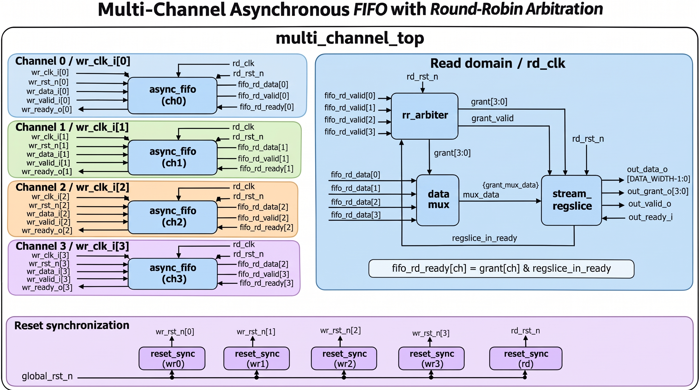
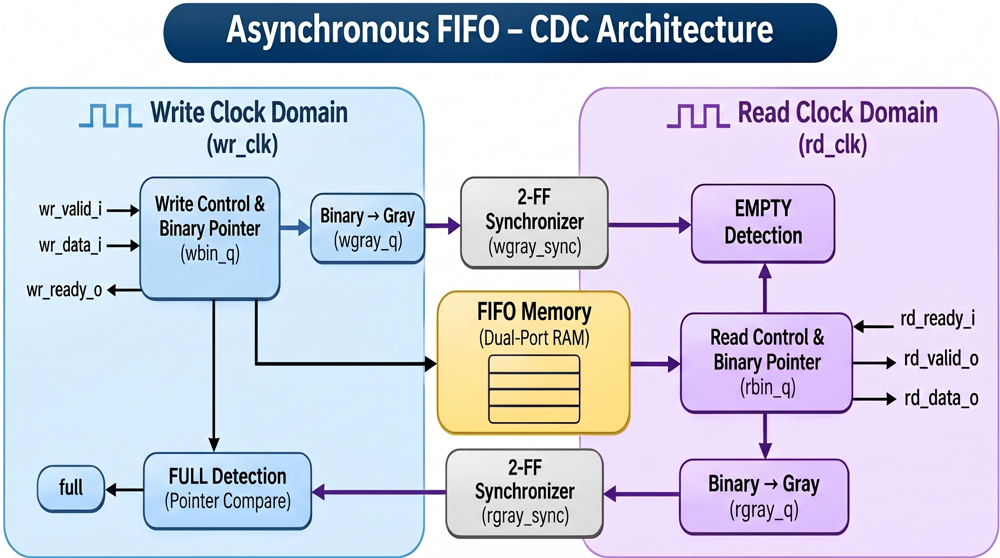

# Multi-Channel Asynchronous FIFO with Round-Robin Arbitration

## Project Overview

A **parameterized SystemVerilog RTL design** that aggregates data from multiple independent input clock domains into a single output stream. The architecture supports a configurable number of input channels, data width, and FIFO depth, with each channel operating on its own write clock and sharing a common read clock.

Each channel uses an **asynchronous FIFO with Gray-coded pointers and two-stage synchronizers** for safe clock-domain crossing (CDC), along with FULL/EMPTY detection and Ready/Valid flow control. A **round-robin arbiter** provides fair channel selection, while an **elastic output register slice** introduces a registered pipeline stage to improve timing and handle downstream backpressure. The selected data and its one-hot channel identifier remain stable until the transfer is accepted. The design also incorporates **per-clock-domain reset synchronization**, with asynchronous active-low assertion and synchronous deassertion.

The project demonstrates **RTL architecture, CDC design, reset synchronization, self-checking functional verification, standard-cell synthesis, and pre-layout static timing analysis (STA)**.


## System Architecture

The system consists of multiple independent write-clock domains connected to a shared read-clock domain. Each input channel operates independently, while the read-domain logic handles arbitration, data selection, and output flow control.

The diagram below illustrates the default **four-channel configuration** (`NUM_CHANNELS = 4`). The architecture supports a configurable number of channels.



*Figure 1: System architecture showing independent input channels, asynchronous FIFOs, round-robin arbitration, data multiplexing, output register slicing, and reset synchronization.*

### Data Flow and Arbitration

Each input channel receives data through its own Ready/Valid interface and stores it in a dedicated asynchronous FIFO. The FIFOs safely transfer data into the shared `rd_clk` domain, where the round-robin arbiter selects among channels containing valid data.

The arbiter generates a one-hot `grant` vector, which controls the data MUX. The selected data and its channel identifier are then packed together and forwarded to the output register slice.

The output interface provides:
- `out_data_o` - selected output data.
- `out_grant_o` - one-hot source identifier (`NUM_CHANNELS` bits).
- `out_valid_o` - indicates valid output data.
- `out_ready_i` - indicates downstream readiness.

### Flow Control and Backpressure

Data transfers are controlled through Ready/Valid handshakes. A FIFO advances only when it is selected and the output register slice is ready to accept its data:

```systemverilog
assign fifo_rd_ready[ch] = grant[ch] && regslice_in_ready;
```

When downstream backpressure occurs, the register slice holds its output data and channel identifier stable until the transfer is accepted. If the register slice is occupied and cannot accept another word, upstream FIFO reads are stalled.

### Reset Synchronization

A common active-low reset (`global_rst_n`) is distributed through **independent reset synchronizers**: one for each write-clock domain and one for the shared read-clock domain.

Each synchronizer supports asynchronous reset assertion and clock-synchronized deassertion, ensuring controlled reset release within its corresponding clock domain.

## RTL Microarchitecture & CDC

| RTL file | Purpose |
|---|---|
| [`async_fifo.sv`](rtl/async_fifo.sv) | Dual-clock FIFO with Gray-coded pointers, two-stage CDC synchronizers, and FULL/EMPTY detection |
| [`reset_sync.sv`](rtl/reset_sync.sv) | Per-domain reset synchronization |
| [`rr_arbiter.sv`](rtl/rr_arbiter.sv) | Round-robin grant generation and backpressure-aware priority tracking |
| [`stream_regslice.sv`](rtl/stream_regslice.sv) | Registered, one-entry elastic Ready/Valid output stage |
| [`multi_channel_top.sv`](rtl/multi_channel_top.sv) | Parameterized integration of FIFOs, arbitration, data selection, and reset handling |


### Asynchronous FIFO: CDC and Pointer Logic

The asynchronous FIFO uses independent write and read pointers to track data occupancy across two clock domains. Each pointer is maintained in both **binary and Gray-code representations**: binary pointers address the FIFO memory, while Gray-coded pointers are used for clock-domain crossing.

The following diagram illustrates the pointer synchronization paths and the local FULL/EMPTY detection logic.



*Figure 2: Asynchronous FIFO architecture showing binary/Gray pointers, bidirectional CDC synchronization, and FULL/EMPTY detection.*

### Pointer Synchronization and Status Detection

Gray coding ensures that only one pointer bit changes between consecutive increments, reducing the risk of sampling inconsistent multi-bit values during clock-domain crossing.

Each Gray-coded pointer passes through a **two-flop synchronizer** in the receiving clock domain, with the registers marked `(* async_reg = "true" *)`.

The FIFO determines its status using the synchronized remote pointers:

- **FULL detection (write domain):** Compares the next write Gray pointer against the synchronized read Gray pointer, with its two most significant bits inverted. In Gray code, this inversion indicates that the write pointer is exactly one full FIFO cycle ahead of the read pointer, meaning the buffer is full.
- **EMPTY detection (read domain):** Compares the next read Gray pointer against the synchronized write Gray pointer.

```systemverilog
wr_full_next  = (wgray_next == (rgray_wr_sync2 ^ FULL_MASK));
rd_empty_next = (rgray_next == wgray_rd_sync2);
```
The FIFO uses **synchronous writes** and an **asynchronous read path (FWFT)**, allowing the current FIFO head to be presented without an additional read-clock cycle when data is available.

### Round-Robin Arbitration

The arbiter maintains a rotating priority pointer to determine which requesting channel receives the next grant.

Its behavior depends on whether the output register slice can accept data:

- **Successful transfer:** The priority pointer advances to the channel following the selected one.
- **Backpressure:** The current grant is held until the register slice accepts the selected word.
- **No active requests:** No grant is issued, and the priority pointer remains unchanged.

This approach prevents a continuously requesting channel from receiving permanent priority over other active channels, while maintaining a stable selection during stalls.

## Functional Verification

The design was verified using three self-checking SystemVerilog testbenches executed with **Verilator**. Verification was performed at both the individual module level and the complete system level, using directed scenarios, deterministic pseudo-random traffic, and reference scoreboards.

### Testbench Coverage

#### 1. Asynchronous FIFO - [`async_fifo_tb.sv`](tb/async_fifo_tb.sv)

Verifies the FIFO independently of the arbitration and output logic, focusing on correct data transfer between unrelated clock domains.

- **FULL/EMPTY and flow control:** Verifies that reads are blocked when the FIFO is empty and writes are stalled when full. Checks that a blocked write is accepted once space becomes available.
- **Data integrity and ordering:** Uses a reference scoreboard to ensure every accepted word is read exactly once and in the correct order.
- **Pointer correctness:** Checks that binary pointers advance only on successful handshakes, Gray-code pointers change by exactly one bit per increment, and both pointers correctly wrap around.
- **Concurrent asynchronous traffic:** Applies simultaneous writes and reads with randomized backpressure under three clock configurations.
- **Reset recovery:** Asserts reset while data is buffered, verifies that stale data is discarded, and confirms correct operation after reset release.

The three clock configurations use write/read periods of **10/14 ns, 4/34 ns, and 38/4 ns**, covering moderately faster writes, significantly faster writes, and significantly faster reads, respectively.

#### 2. Round-Robin Arbiter - [`rr_arbiter_tb.sv`](tb/rr_arbiter_tb.sv)

Verifies arbitration independently using a reference model that predicts the expected grant and tracks priority updates.

- **Grant correctness:** Checks idle behavior, individual requests, one-hot grant generation, and selection only among requesting channels.
- **Priority rotation:** Verifies that grants follow round-robin order and that priority advances only after an accepted transfer.
- **Backpressure handling:** Ensures the selected grant and arbitration priority remain stable while downstream acceptance is stalled.
- **Fairness and starvation prevention:** Tracks how long continuously requesting channels wait, ensuring they are serviced within the defined round-robin fairness bound.
- **Dynamic traffic and reset:** Tests changing request patterns, randomized downstream stalls, and priority restoration after reset during a stalled grant.

#### 3. Full System Integration - [`multi_channel_top_tb.sv`](tb/multi_channel_top_tb.sv)

Verifies the complete data path, including asynchronous FIFOs, arbitration, data multiplexing, reset synchronization, and the output register slice.

The test uses four independent write clocks and a shared read clock, with a dedicated reference scoreboard for each channel.

- **End-to-end data integrity:** Verifies that output data matches the expected word for the granted channel, preserving per-channel ordering and detecting missing, duplicate, or misrouted transactions.
- **FIFO backpressure:** Fills all input FIFOs while blocking downstream transfers, verifying FULL conditions and correct recovery when output transfers resume.
- **Output stability:** Ensures `out_valid_o`, `out_data_o`, and `out_grant_o` remain stable throughout downstream stalls.
- **Channel isolation:** Activates each source independently and verifies that no disabled channel produces output data.
- **Sustained throughput:** Confirms that the system delivers one accepted output word per read-clock cycle for 40 consecutive cycles.
- **Randomized traffic:** Exercises all channels simultaneously with varying source activity and downstream backpressure.
- **Reset synchronization and recovery:** Verifies reset release across all clock domains, discards buffered transactions during global reset, and checks correct operation after restart.


## ASIC Synthesis & Static Timing Analysis

The RTL was synthesized using **Yosys**, mapped to the **Nangate45** standard-cell library, and evaluated using **OpenROAD** for pre-layout static timing analysis (STA).

All results correspond to the default configuration: **4 channels, 32-bit data width, and FIFO depth of 16**.

### Standard-Cell Synthesis

The synthesized design was mapped to Nangate45 standard cells, providing an estimate of the implementation's logic complexity and cell area.

| Metric | Result |
|---|---:|
| Total standard cells | **7,543** |
| Flip-flops | 2,262 |
| Multiplexers | 2,546 |
| Other logic cells | 2,735 |
| **Total mapped cell area** | **18,077.094 µm²** |

<details>
<summary><strong>View Standard-Cell Utilization Report</strong></summary>


</details>


### Static Timing Analysis

Pre-layout STA was performed using **OpenROAD** under three clock configurations, evaluating setup, hold, recovery, and removal timing constraints.

| Scenario | Read Clock | Write Clocks (CH0–CH3) | Setup Slack | Hold Slack | Recovery | Removal | Status |
|---|---:|---|---:|---:|---:|---:|---|
| Uniform | 100 MHz | 100 / 100 / 100 / 100 MHz | +3.64 ns | +0.08 ns | +4.50 ns | +4.83 ns | **PASS** |
| Slow Writes | 100 MHz | 80 / 70 / 60 / 50 MHz | +3.64 ns | +0.08 ns | +4.50 ns | +4.83 ns | **PASS** |
| Mixed | 80 MHz | 100 / 90 / 70 / 60 MHz | +4.21 ns | +0.08 ns | +4.86 ns | +4.89 ns | **PASS** |

**All three scenarios passed**, with positive setup, hold, recovery, and removal slack.

<details>
<summary><strong>View OpenROAD STA Report</strong></summary>


</details>

**Timing methodology:** The SDC constraints define independent asynchronous clock groups, excluding inter-domain setup/hold timing checks. The reported results are **pre-layout estimates**, not post-route timing closure or physical signoff.


## How to Run

### Functional Simulation

**Requirements:** Linux (or WSL), Verilator with `--binary`/`--timing` support, a C++ compiler (such as `g++`), and `make`.

From the repository root:

```bash
bash scripts/run_all_tbs.sh
```
The script compiles all three testbenches and runs the asynchronous FIFO test in clock modes 0, 1, and 2. 

### ASIC Synthesis and Timing

**Requirements:** compatible Yosys with `read_slang` support, OpenROAD, Python 3, and the Nangate45 Liberty/LEF technology files.

Run the complete ASIC analysis flow:

```bash
bash scripts/run_asic_checks.sh
```

The script automatically performs the following steps:

1. **RTL Synthesis:** Synthesizes the SystemVerilog design using Yosys and maps it to Nangate45 standard cells.
2. **Cell Utilization:** Reports the mapped cell count, flip-flop and multiplexer utilization, and total cell area.
3. **Static Timing Analysis:** Runs OpenROAD pre-layout STA on the synthesized netlist under three clock configurations.
4. **Timing Verification:** Evaluates Setup, Hold, Recovery, and Removal slack, reporting PASS/FAIL for each scenario.

The generated gate-level netlist is saved in `netlist/`, while synthesis and timing reports are saved in `reports/`.

**Environment setup:** The script uses a local OpenROAD-flow-scripts installation. Tool and library paths may need to be adjusted in [`run_asic_checks.sh`](scripts/run_asic_checks.sh) to match your environment.


## Repository Structure

```text
multi_channel_async_fifo/
├── rtl/                                # Synthesizable RTL
│   ├── async_fifo.sv                   # Dual-clock FIFO with Gray-code CDC
│   ├── reset_sync.sv                   # Reset synchronizer
│   ├── rr_arbiter.sv                   # Round-robin arbiter
│   ├── stream_regslice.sv              # Elastic Ready/Valid register slice
│   └── multi_channel_top.sv            # Parameterized top-level integration
│
├── tb/                                 # Self-checking testbenches
│   ├── async_fifo_tb.sv
│   ├── rr_arbiter_tb.sv
│   └── multi_channel_top_tb.sv
│
├── scripts/                            # Automated verification and ASIC flow
│   ├── run_all_tbs.sh                  # Run functional simulations
│   └── run_asic_checks.sh              # Run synthesis and pre-layout STA
│
├── constraints/                        # Static timing constraints
│   ├── multi_channel_top.sdc
│   ├── multi_channel_top_slow_writes.sdc
│   └── multi_channel_top_mixed.sdc
│
├── docs/                               # Diagrams and implementation results
│   ├── system_architecture.jpeg
│   ├── async_fifo_cdc_architecture.jpeg
│   ├── standard_cell_utilization.png
│   └── sta_results.png
│
├── .gitignore
└── README.md
```
## Project Summary

This project implements a **parameterized multi-clock SystemVerilog RTL architecture**, integrating asynchronous FIFOs, Gray-coded CDC synchronization, round-robin arbitration, and Ready/Valid backpressure for lossless data streaming across independent clock domains.

Functional verification was performed using **Verilator**, with self-checking testbenches, scoreboards, and randomized multi-clock traffic. ASIC synthesis using **Yosys and Nangate45** resulted in **7,543 mapped standard cells**, while **OpenROAD/OpenSTA pre-layout timing analysis** reported positive setup and hold slack across multiple clock-frequency configurations.

The project covers key stages of the **ASIC Front-End design flow**, from RTL development and functional verification to standard-cell synthesis and pre-layout timing analysis.
